# Basic

## Typography

- Label font size / alignment / color example

## Style

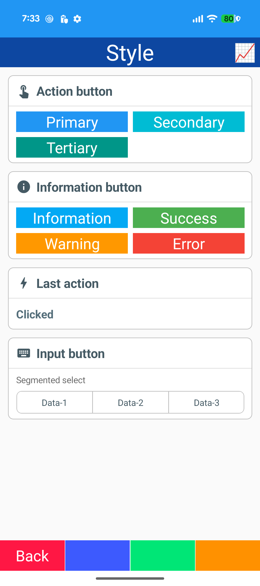

- Button styles: Primary / Secondary / Tertiary / Information / Success / Warning / Error
- Segmented select

## Font

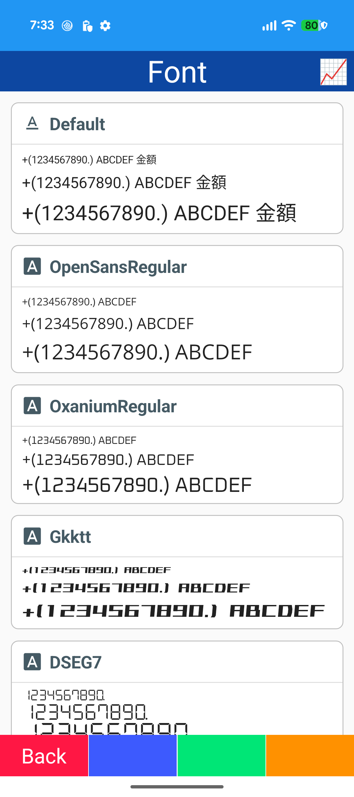
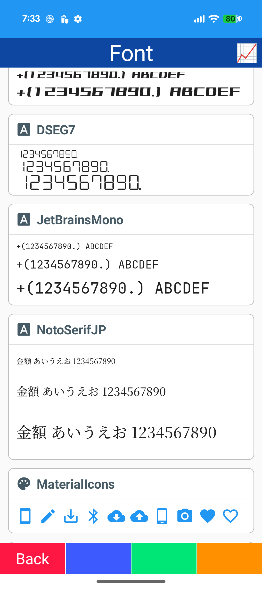
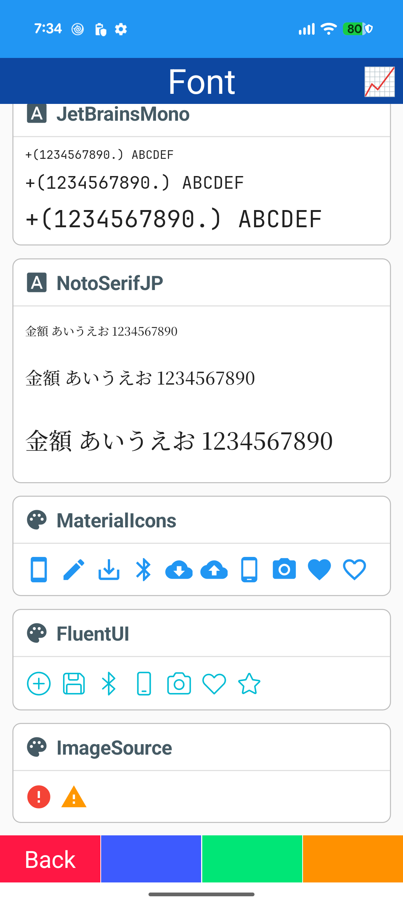

- Bundled fonts: OpenSans / Oxanium / Gkktt / DSEG7 / JetBrains Mono / Noto Serif JP
- Icon fonts: MaterialIcons / FluentUI
- FontImageSource

## Converter

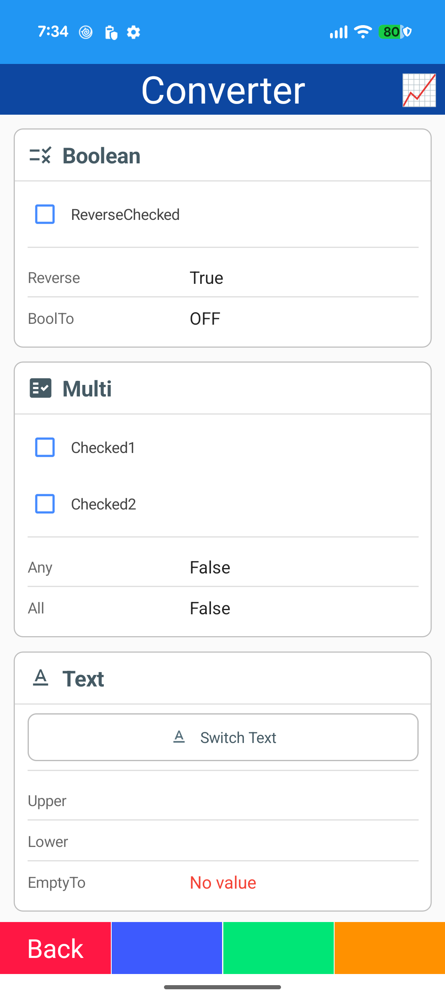

- Smart.Maui converters: Reverse / Any / All / ToUpper / ToLower
- Inline converters: BoolToText / BoolToColor / NullToText / NullToColor
- MultiBinding

## Behavior

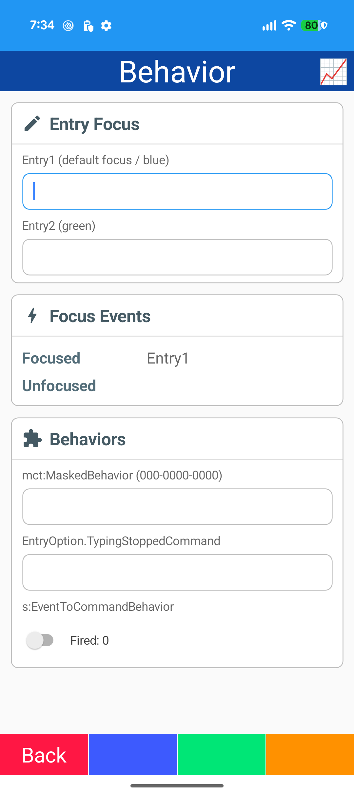

- DefaultFocusBehavior
- Focus border (FocusedStroke)
- EventToCommandBehavior
- MaskedBehavior (CommunityToolkit)
- TypingStoppedCommand
- Highlight / bounce triggers

## Locale

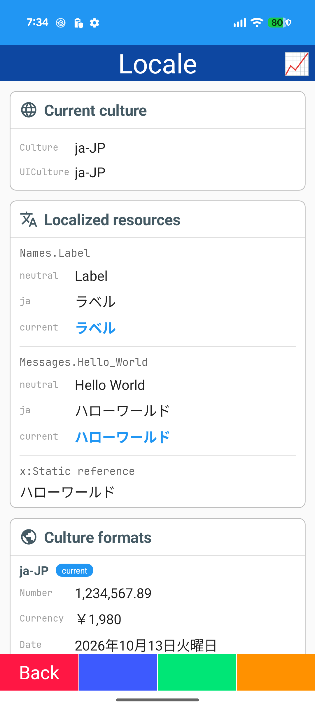
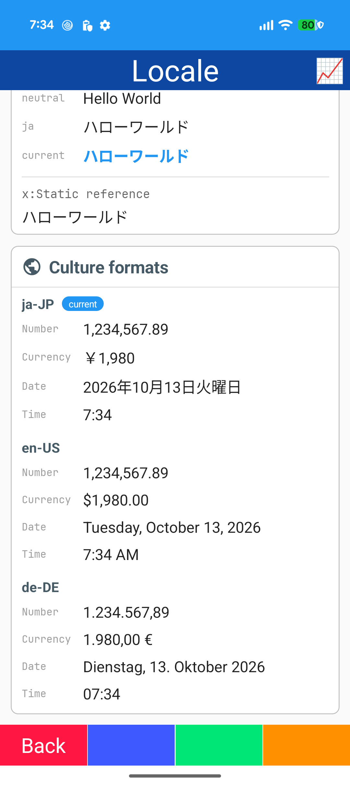

- CurrentCulture / CurrentUICulture
- .resx resources (neutral / ja)
- x:Static resource strings
- Culture formats: number / currency / date / time

## Dialog

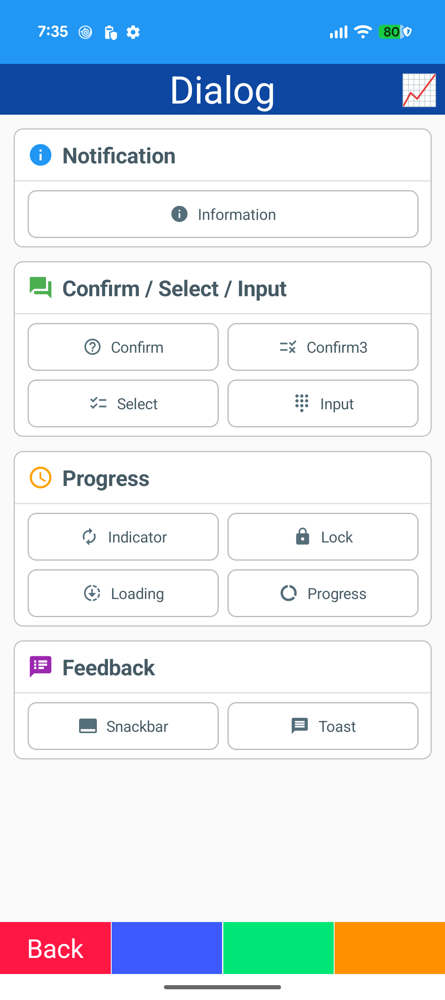

- IDialog (MauiComponents)
- Information / Confirm / Select / Prompt
- Indicator / Lock / Loading / Progress
- Snackbar / Toast

## Validation

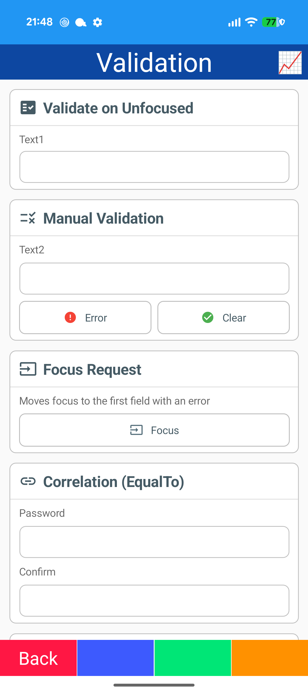
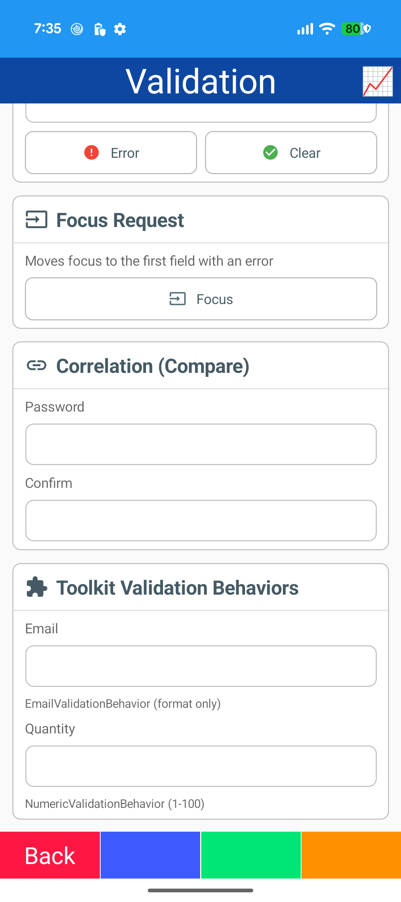

- DataAnnotations (Required / EqualTo)
- Validation on focus lost
- Error label / flash / red border
- Manual errors (AddError)
- Focus to first error
- Email / Numeric validation behaviors (CommunityToolkit)

## Setting

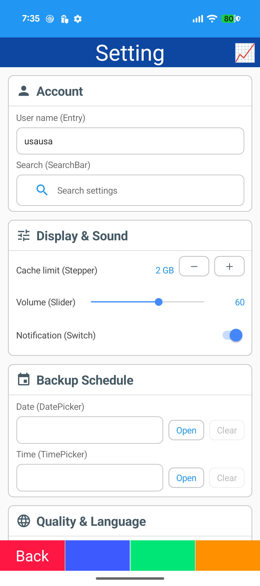
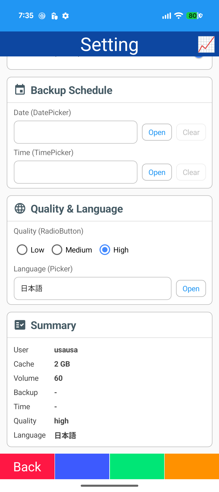

- Entry / SearchBar / Stepper / Slider / Switch
- DatePicker / TimePicker (nullable)
- RadioButton group / Picker
- Outlined fields / outlined Stepper
- Summary card (StringFormat)
