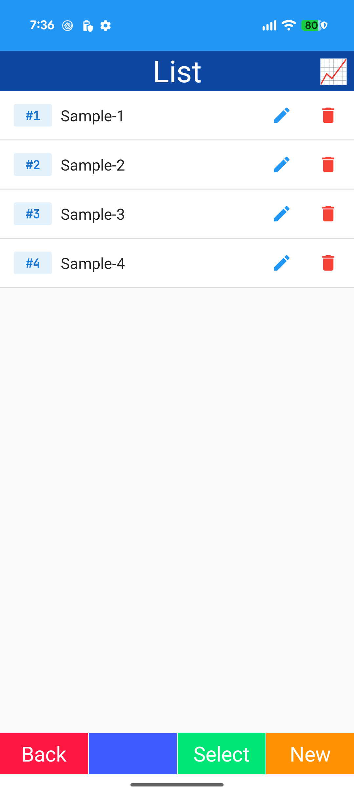
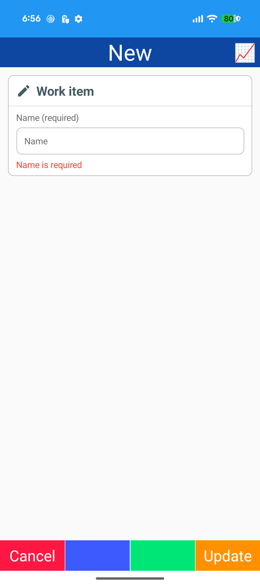
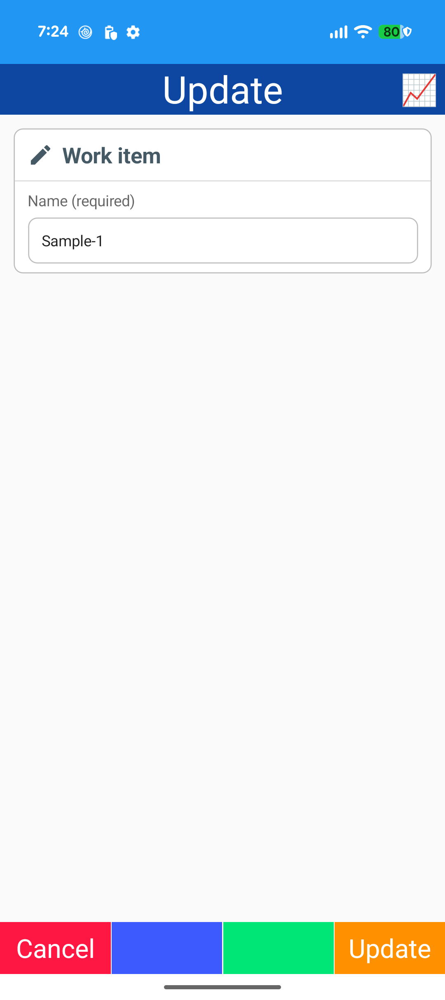
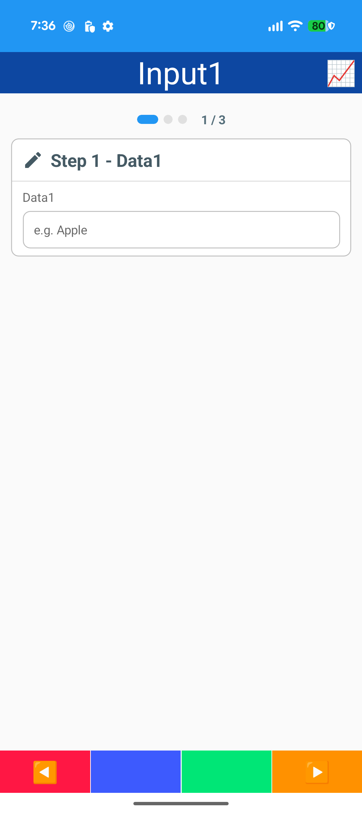
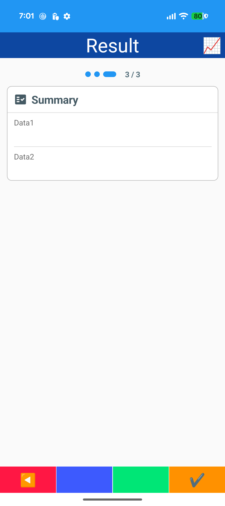
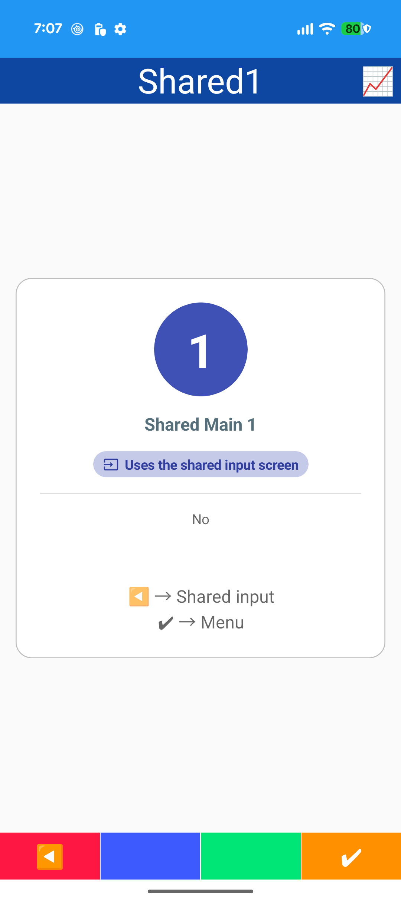
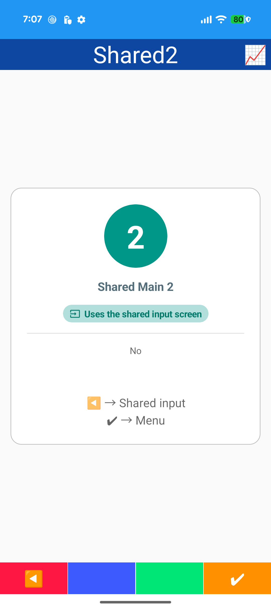
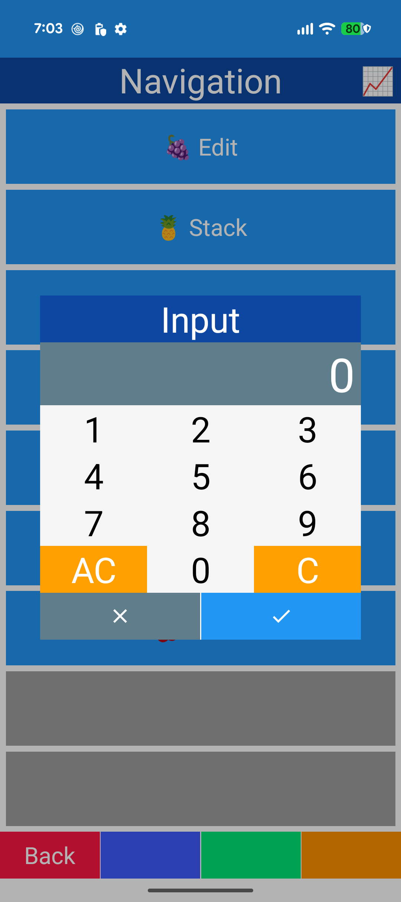

# Navigation

## Edit

- NavigationParameter
- Edit screen for New / Update

## Stack

- Stacked navigation (Push / Pop)

## Wizard

- Scope plugin ([Scope] context)
- Scope lifecycle log

## Shared

- Shared input screen
- Named NavigationParameter
- Parameters helper

## Initialize

- Initialization after arrival

## Cancel

- Confirm dialog on arrival

## Dialog

- Popup (IPopupNavigator)

## Effect

- Navigation effects: slide / fade / zoom / drop / flip / rotate
