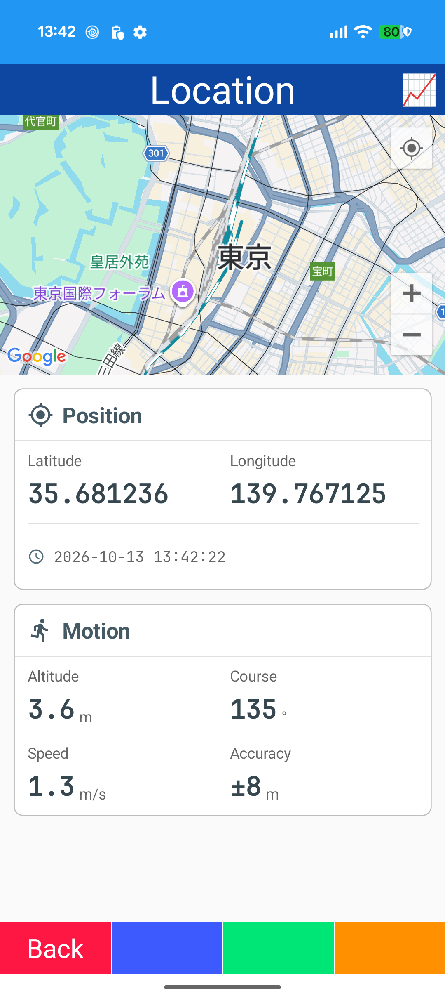
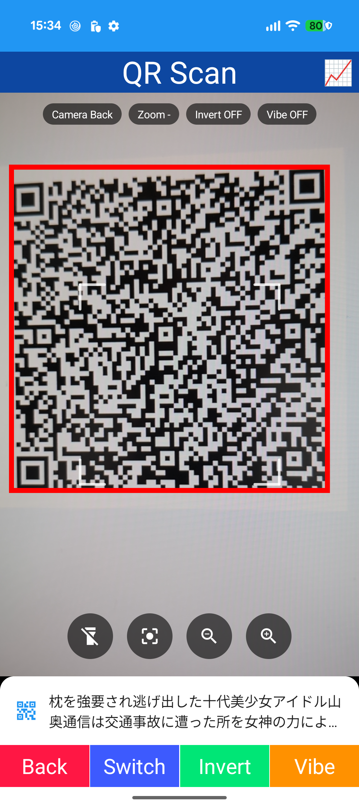
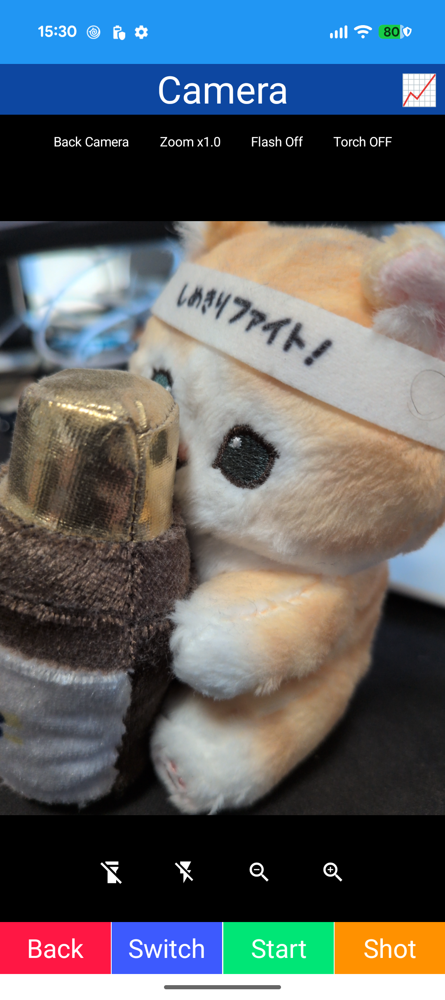
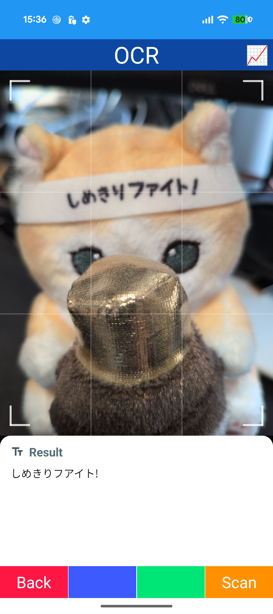
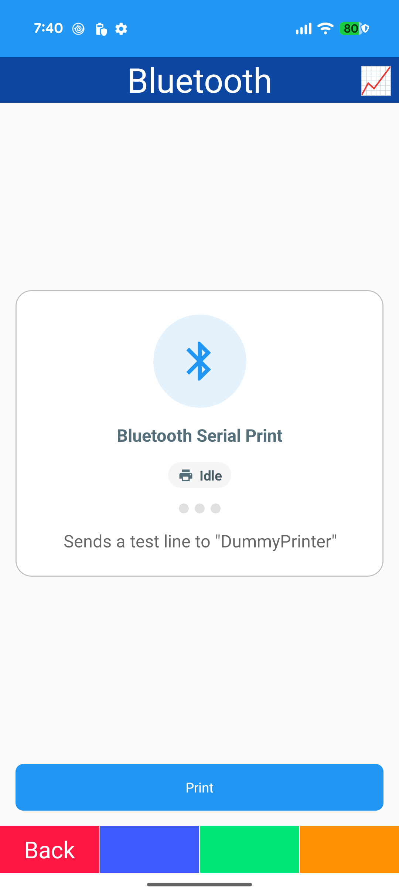
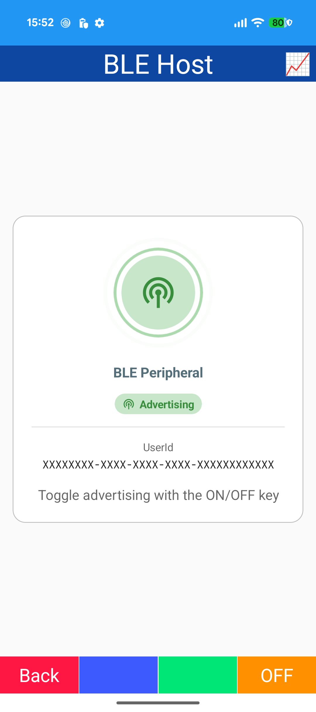
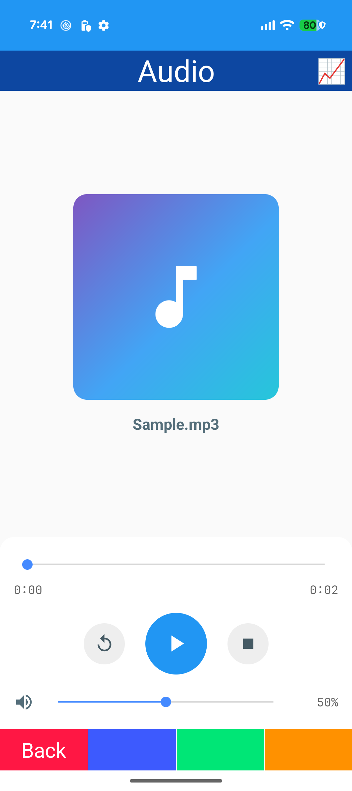
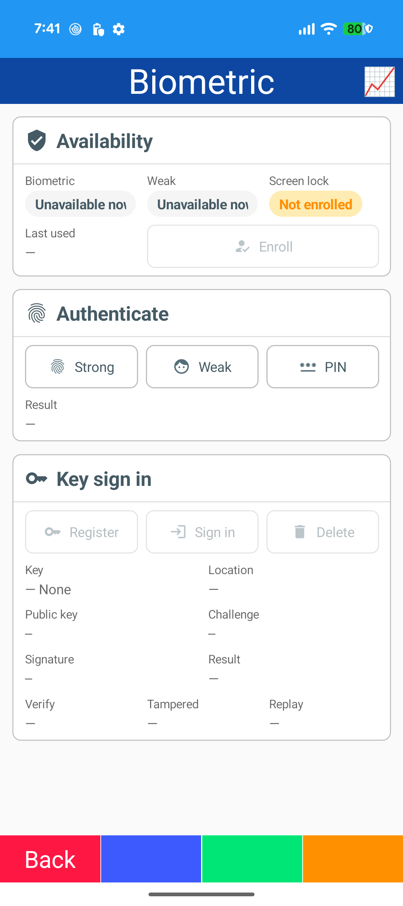

# Device

## Info

- IDeviceInfo / IAppInfo / IDeviceDisplay

## Status

- Battery / network state

## Sensor

- Accelerometer / Gyroscope / Magnetometer / Orientation / Compass / Barometer
- Compass dial / bubble level

## Location

- Map (Microsoft.Maui.Controls.Maps)
- ILocationService

## QR Display

- QRCoder

## QR Scan

- CameraView (BarcodeScanning.Native.Maui / ML Kit)
- Detection boxes (GraphicsView)

## Camera

- CameraView (CommunityToolkit.Maui.Camera)
- Preview / capture / flash / torch / zoom

## OCR

- CameraView
- Text recognition (ML Kit / IOcrReader)

## WiFi

- IWiFiManager

## Bluetooth

- Bluetooth Classic serial (SPP)

## BLE Scan

- Shiny.BluetoothLE scan

## BLE Host

- Shiny.BluetoothLE.Hosting
- GATT service / advertising

## NFC

- NFC reader mode (FeliCa)

## Audio

- Plugin.Maui.Audio

## Activity

- Step counter (SensorManager)

## Biometric

- BiometricManager / BiometricPrompt
- Keystore EC key
- Signature verification

## Communication

- Phone dialer / SMS / email

## Misc

- Screen: keep awake / orientation / brightness / screenshot
- Vibration / haptic feedback / flashlight
- Text to speech / speech to text
- Notifications: immediate / scheduled / action buttons
