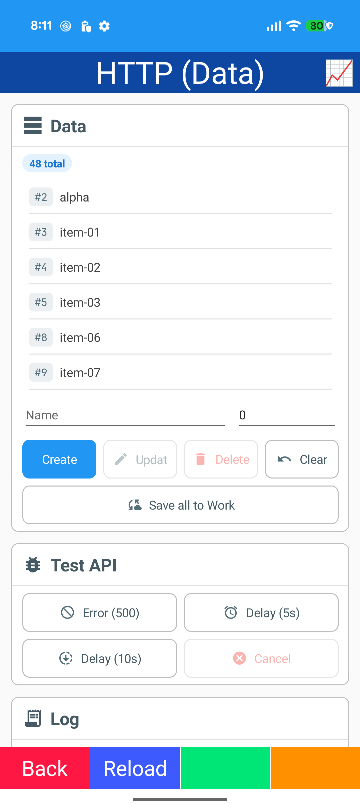
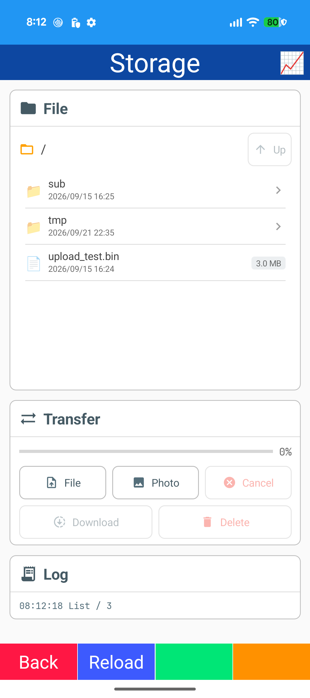
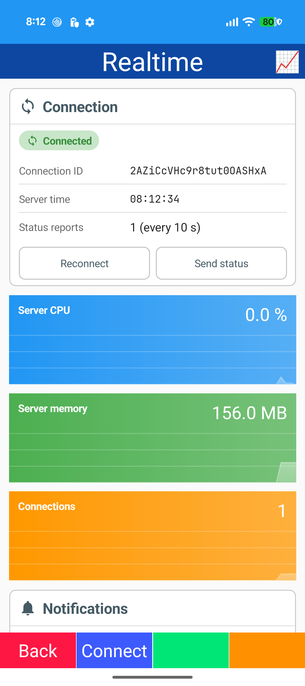
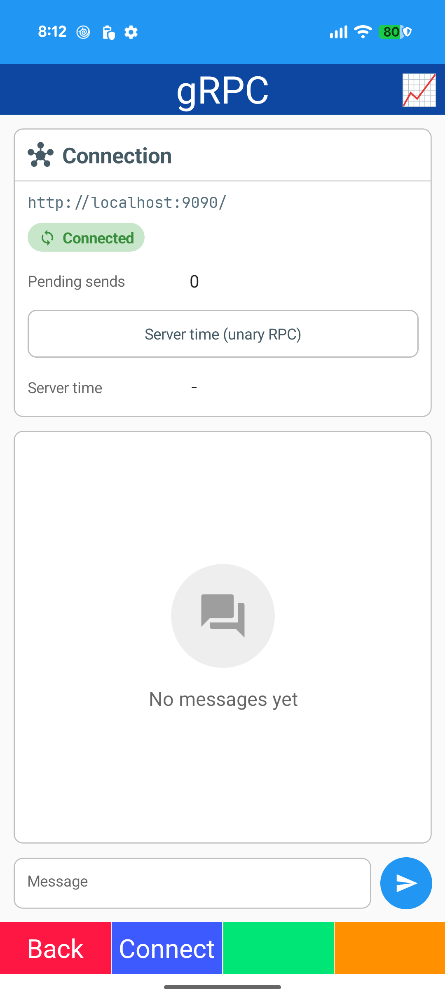
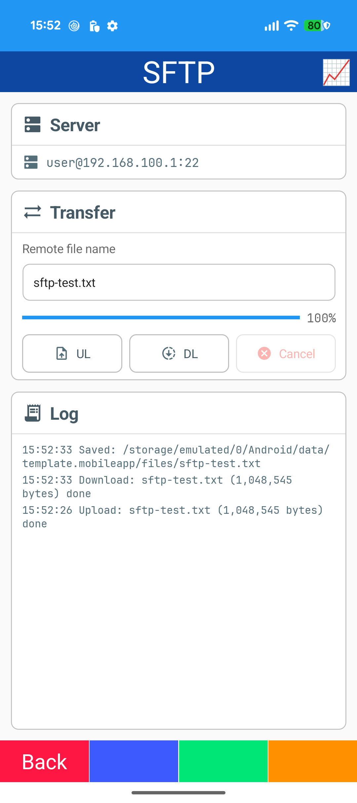
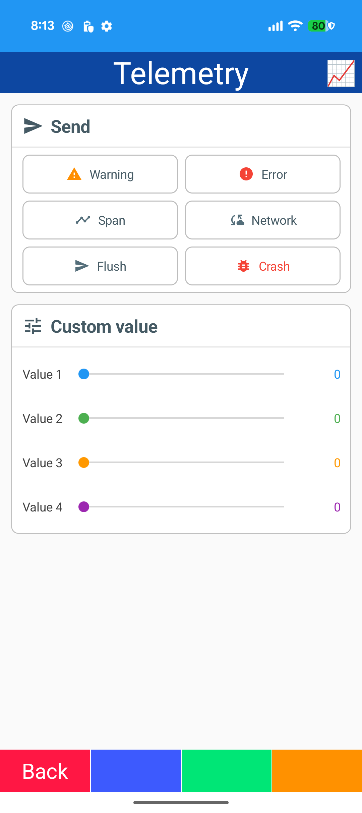

# Network

## HTTP (Data)

- Rester / System.Text.Json
- CRUD
- Error retry / cancel

## HTTP (Auth)

- JWT login
- ApiContext / ApiDelegatingHandler

## Storage

- Upload / download
- Progress / cancel

## Realtime

- SignalR

## gRPC

- Grpc.Net.Client
- Bidirectional streaming chat

## SFTP

- SSH.NET SftpClient
- Upload / download / progress / cancel

## Telemetry

- OpenTelemetry: traces / metrics / logs (OTLP/HTTP)
- Span / log / flush
- CrashReport
