# View

## Layout

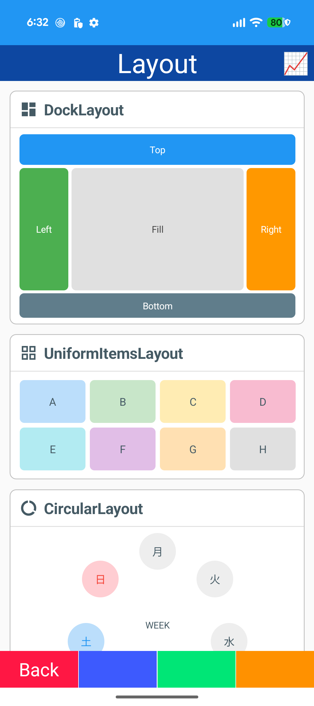

- DockLayout / UniformItemsLayout
- CircularLayout / HoneycombLayout / CascadeStackLayout
- StaggeredGrid / VariableSizeWrapPanel / OverlapPanel

## State

- StateContainer (Loading / Empty / Error)

## Border

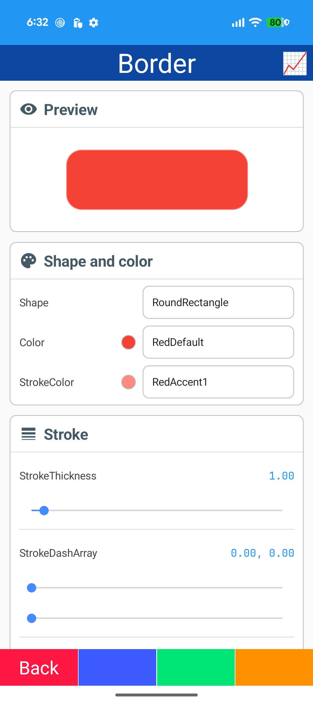

- Border

## Shadow

- Shadow
- Neumorphism card

## Animation

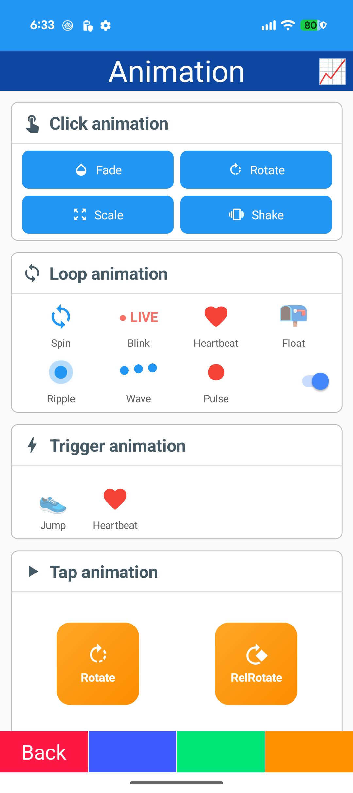

- EventActionBehavior (fade / rotate / scale / shake)
- TapActionBehavior / SpringAnimation
- Loop animations: spin / blink / heartbeat / float / ripple / wave / pulse
- Trigger animations

## Easing

- Easing functions

## Effect

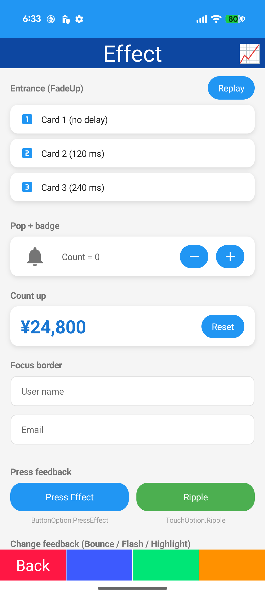
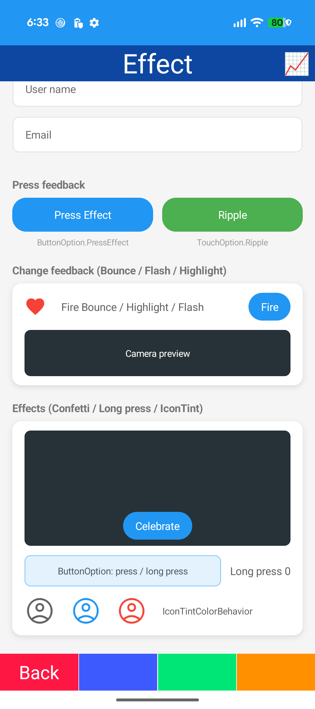

- Entrance animation (fade-up / pop)
- Count up
- Focus border
- Press effect / ripple
- Bounce / highlight / flash
- Confetti / long press / icon tint

## Drag & Drop

- Drag / Drop gesture recognizers

## Graphics

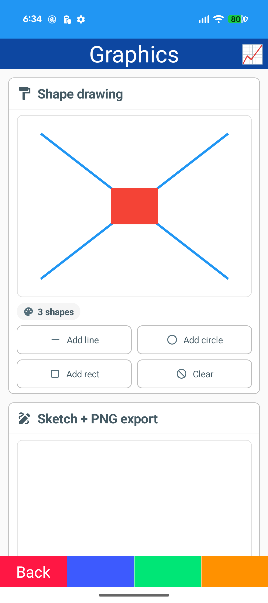

- Microsoft.Maui.Graphics (GraphicsView)
- Shapes
- Sketch / PNG export

## Drawing

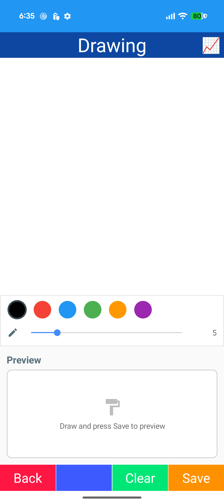

- DrawingView (CommunityToolkit.Maui)
- Save (SkiaSharp)

## Lottie

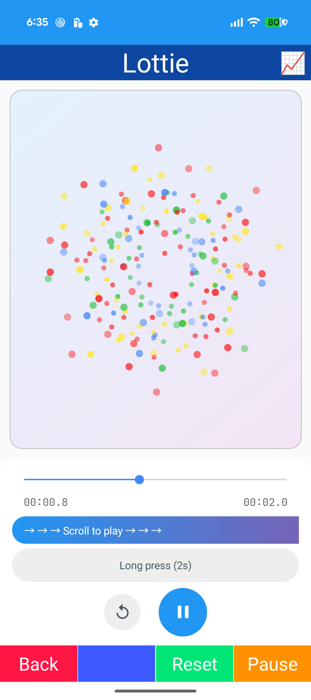

- SKLottieView
- Scroll-linked playback
- Press-and-hold playback

## SVG

- SvgView (Svg.Skia)

## Bottom Sheet

- SfBottomSheet (Syncfusion)
- BottomSheetView

## Drawer

- SfNavigationDrawer (Syncfusion)
- SideDrawer

## Toolkit

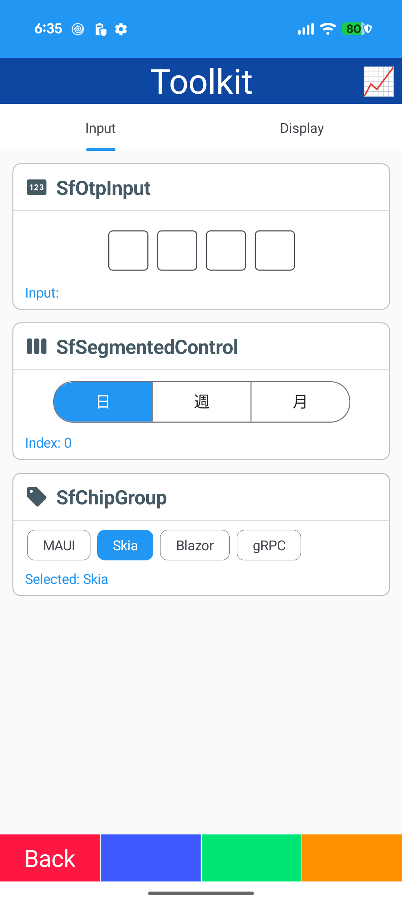

- SfTabView (Syncfusion)
- SfOtpInput / SfSegmentedControl / SfChipGroup
- AvatarView / RatingView / Expander
- SfAccordion

## Custom

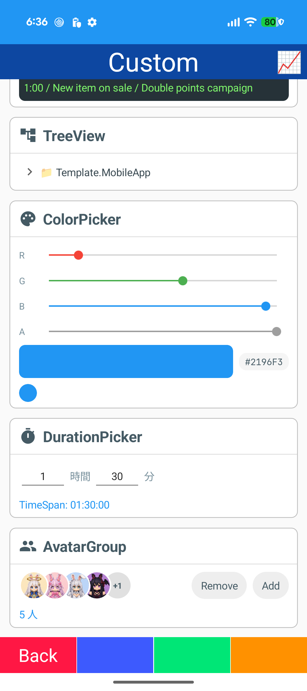

- MarqueeLabel
- TreeView
- ColorPicker / DurationPicker
- AvatarGroup

## Clam Chart

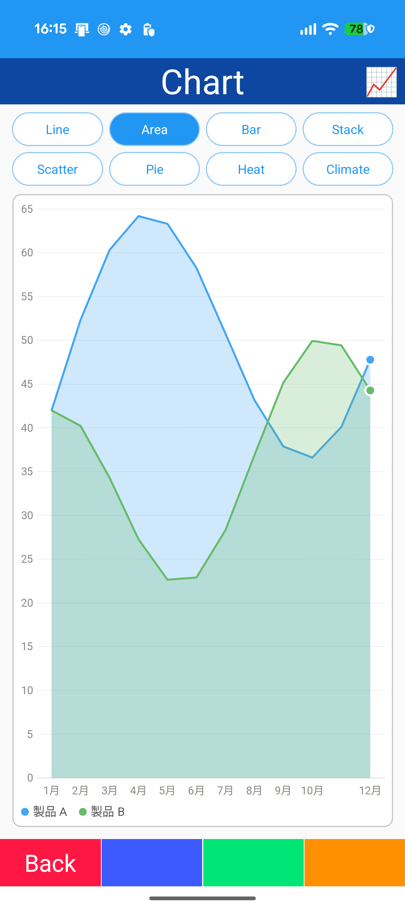
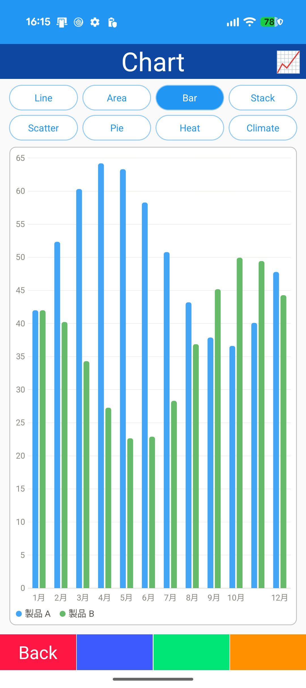
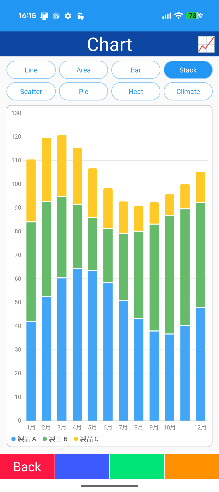
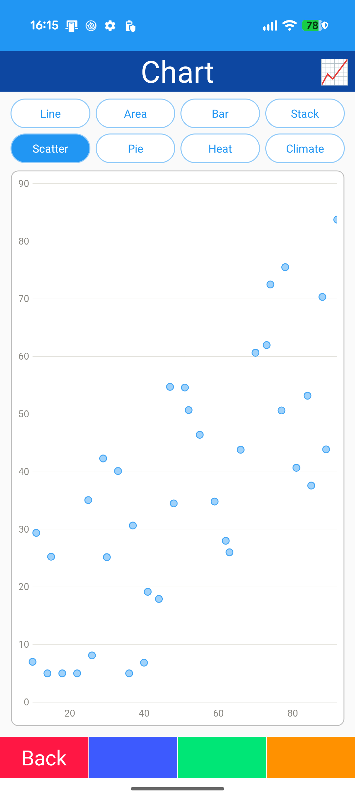
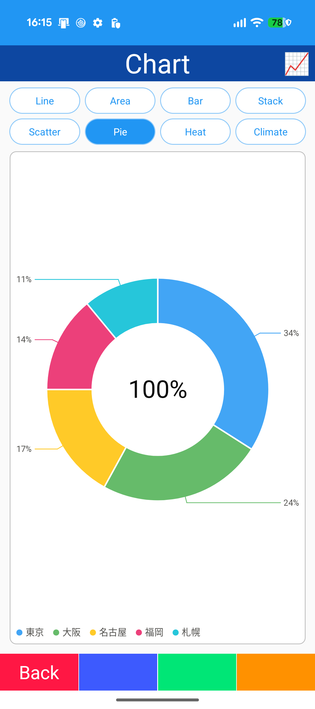
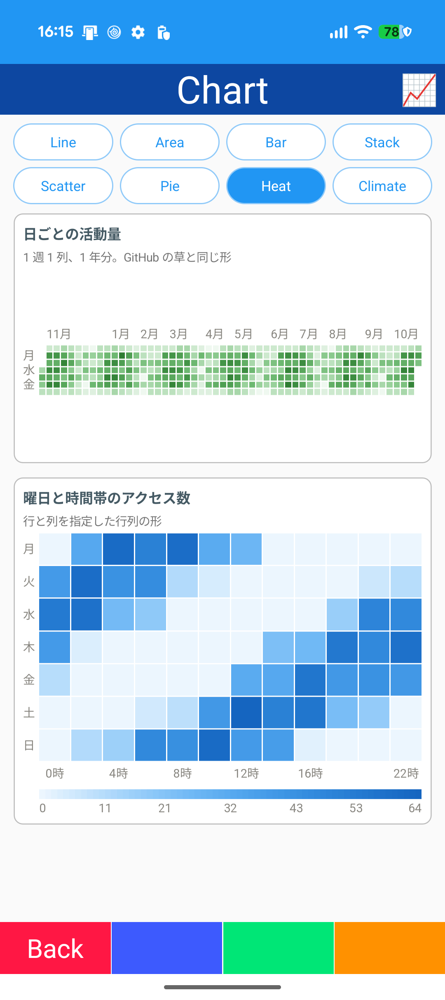
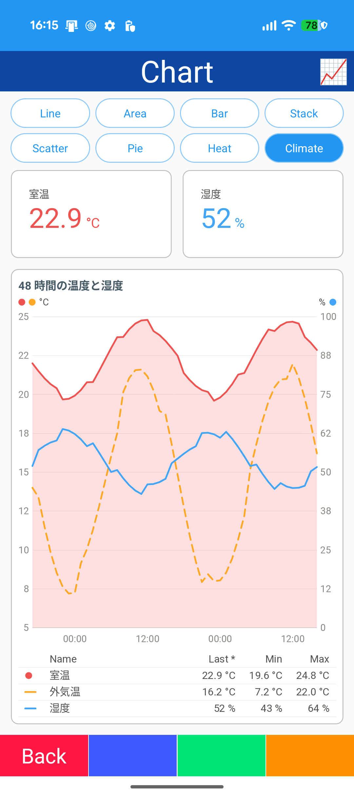

- ClamChart: Line / Area / Bar / Stacked / Scatter / Pie / Heatmap / Climate in tabs
- Heatmap: calendar like GitHub / matrix
- Climate: secondary axis / legend table

## Sf Chart

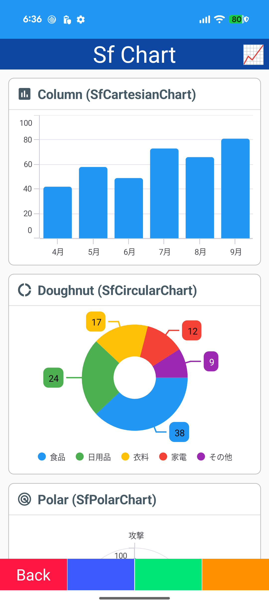
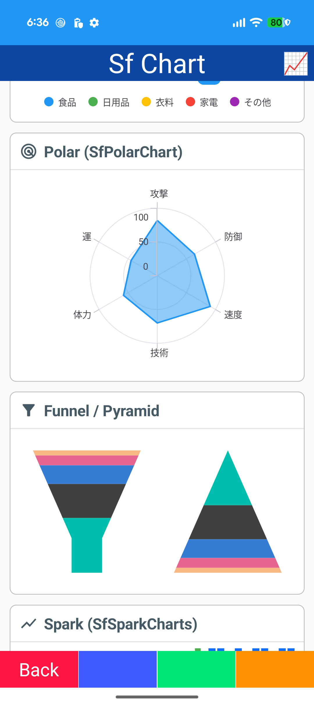
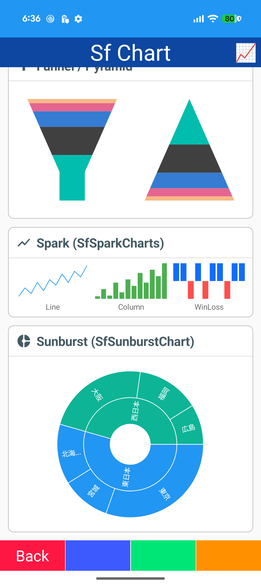

- Syncfusion Cartesian / Circular / Polar charts
- Funnel / Pyramid
- Spark charts
- Sunburst
