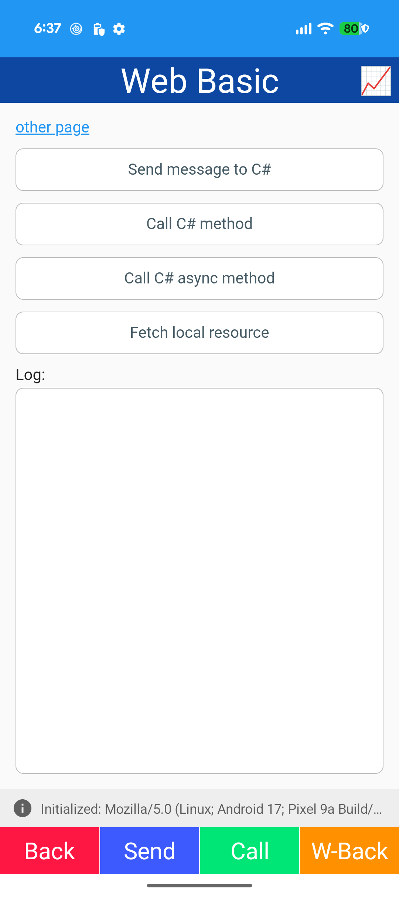
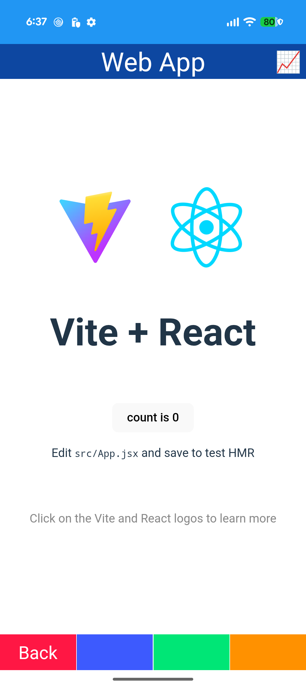
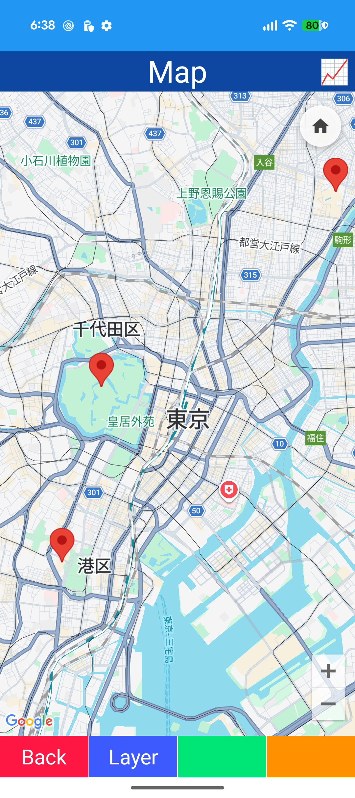
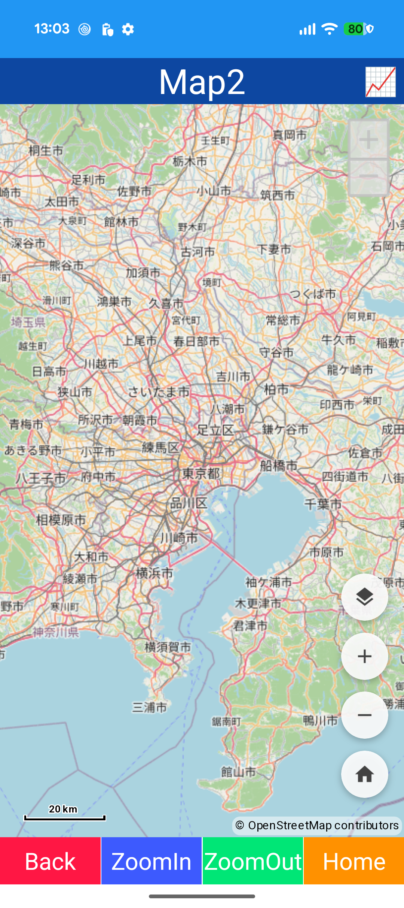
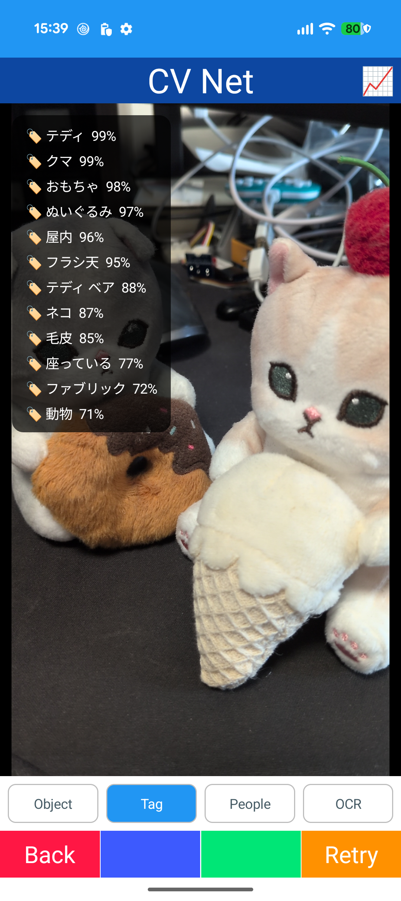
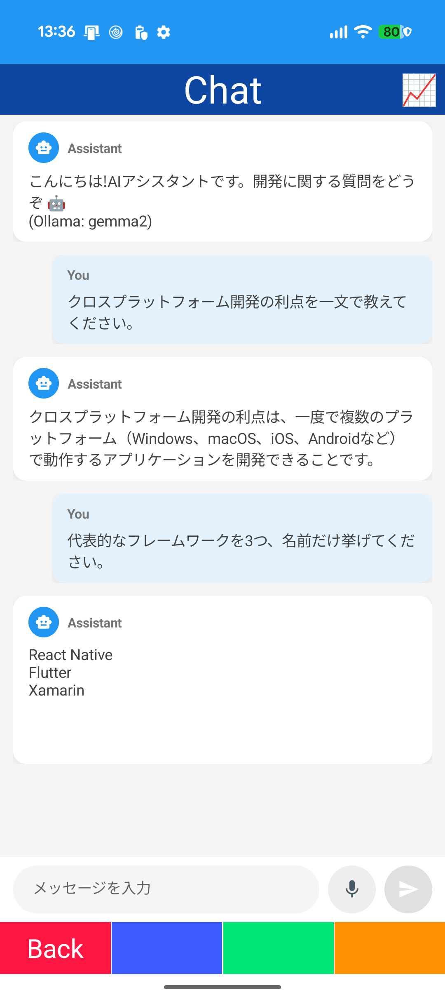
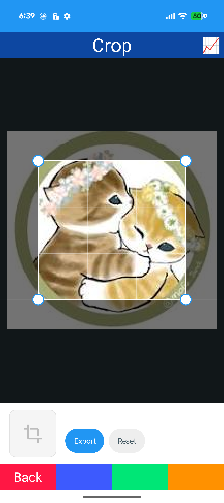

# Sample

## Web Basic

- HybridWebView
- JavaScript / C# messaging (InvokeDotNet / InvokeJavaScriptAsync)
- WebResourceRequested

## Web App

- HybridWebView
- Vite + React app

## Map

- Map (Microsoft.Maui.Controls.Maps / Google Maps)
- Polyline / Polygon / Circle

## Map2

- Mapsui (OpenStreetMap)
- Widgets / spots / shapes / GeoJSON / clusters
- SkiaSharp overlay

## Media

- MediaElement
- Custom control bar

## Markdown

- MarkdownView
- Heading / list / quote / code / table / link

## PDF

- PdfView
- Page navigation

## CV Net

- Azure AI Vision Image Analysis (Object / Tag / People / OCR)

## CV Local

- ONNX Runtime (object detection)

## Chat

- ChatView
- OllamaSharp / IChatClient
- Streaming response

## Crop

- CropDrawing
- IInteractiveDrawing
