# UI

## Profile

- Parallax cover / overlapping avatar

## Login

## Money

## Super

## POS

## Shop

## Grid

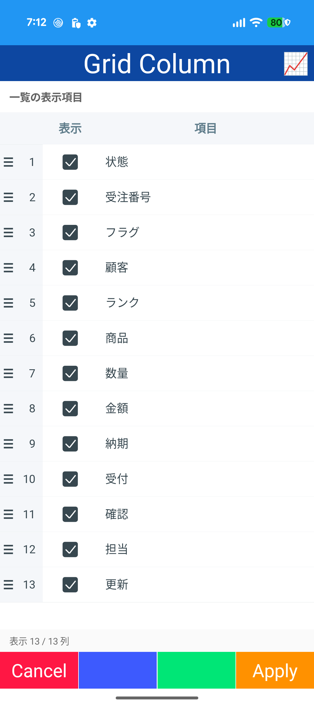

- ClamGrid

## Visit

## Calendar

- ClamCalendar

## Schedule

## Mail

## Chat

## Weather

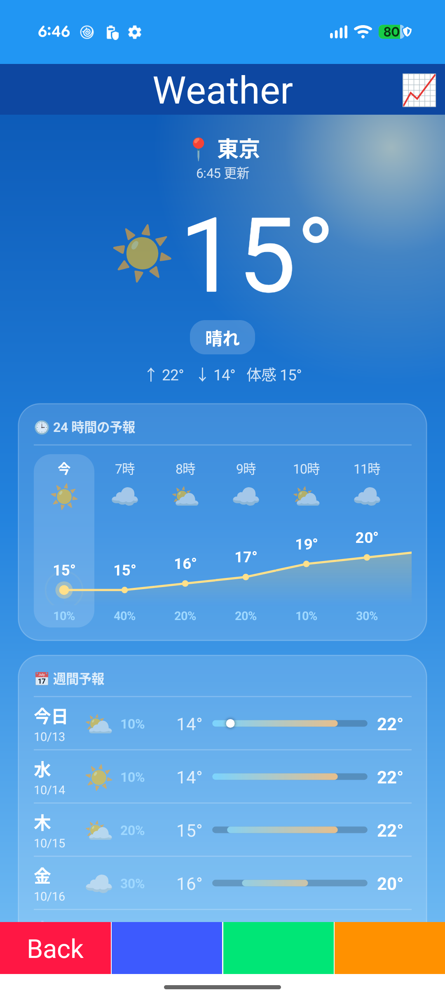
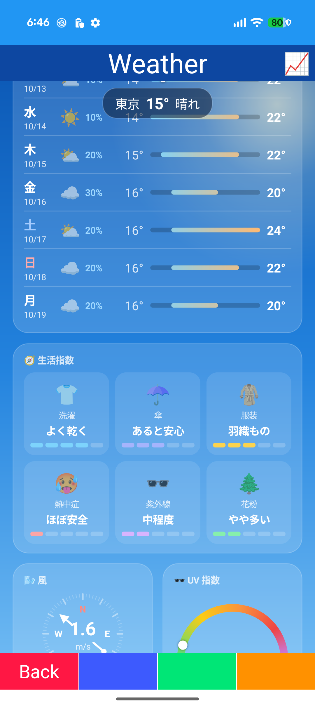

## News

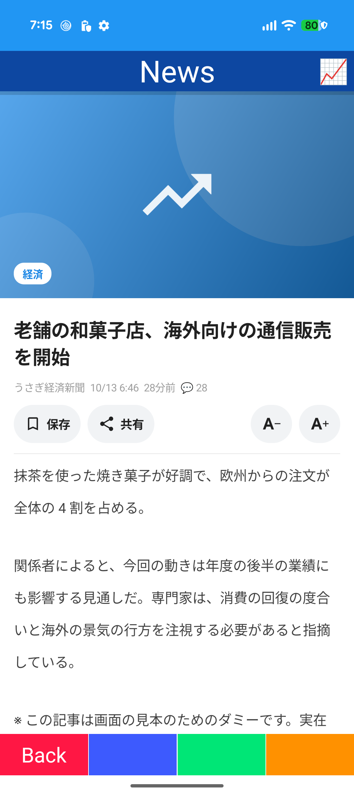

## Timeline

## Kit

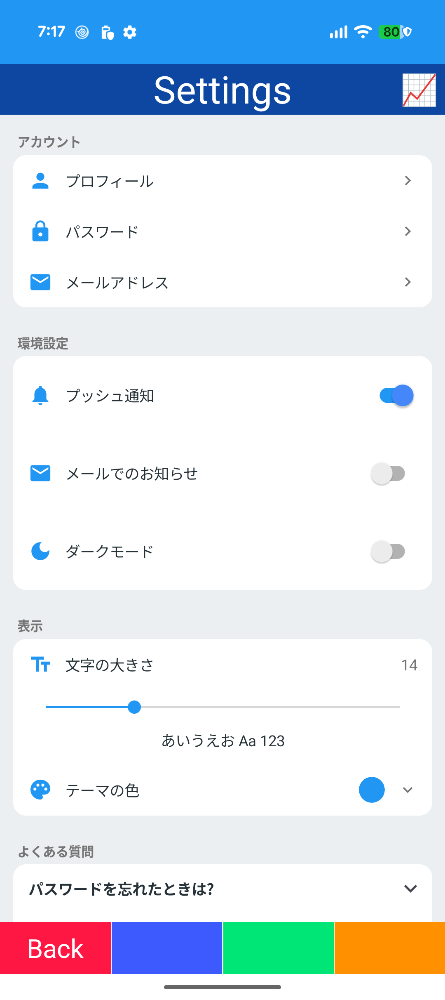

## Stream

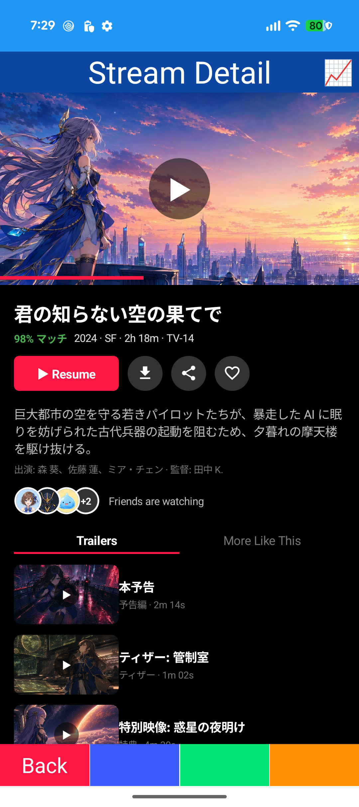

## Dock

## Home

## Habit

## Graph

## Graph2

## Load

## Gauge

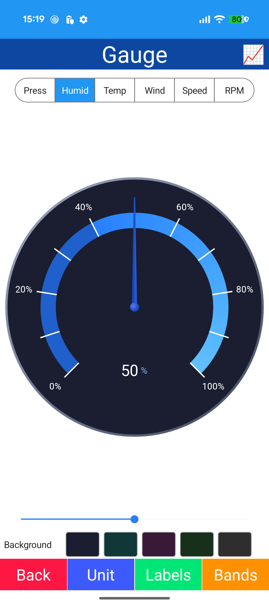
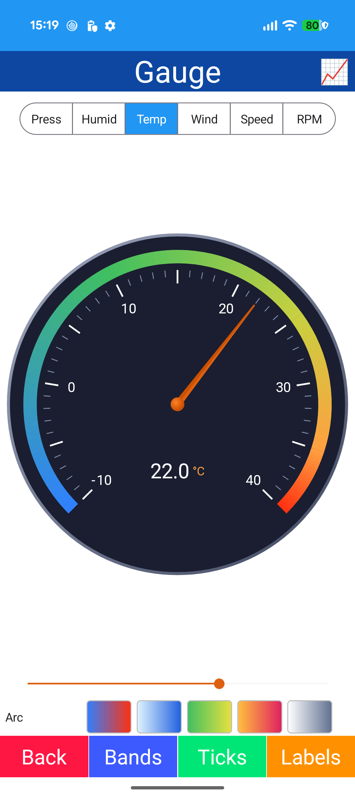
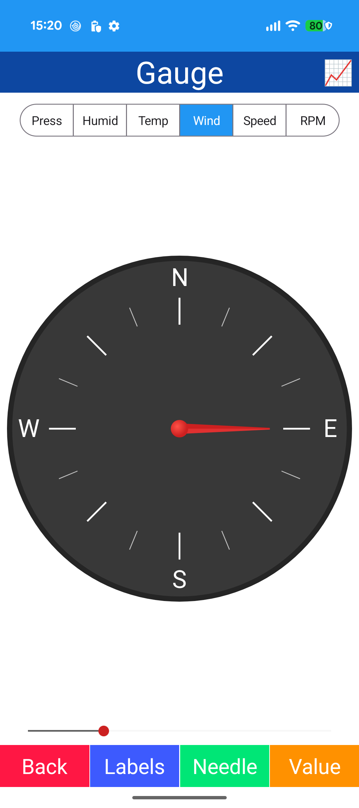
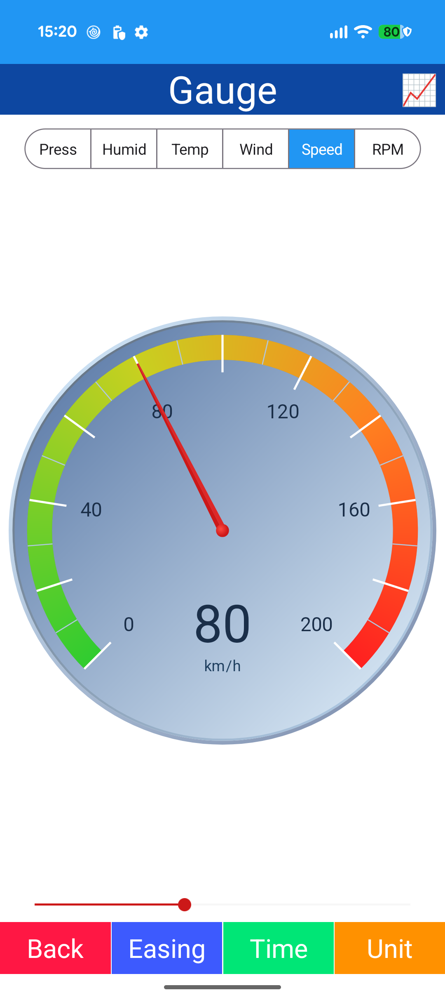
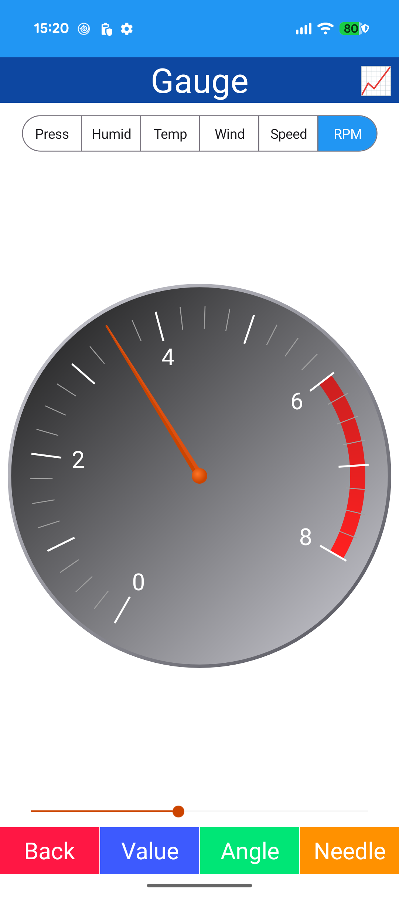

## Meter

## Mixer

## TreeMap

## Radar

## Wheel

## Monster

## Character

## Social

## Flight

## Tactical

## Telemetry

## Energy

