# UI Proposal

Proposed UI sample screens. Images are mockups rendered at the same size as the device screenshots in
[Images](./Images); their sources are in [Mockup](./Mockup).

# 🅰 Primary

## Transit

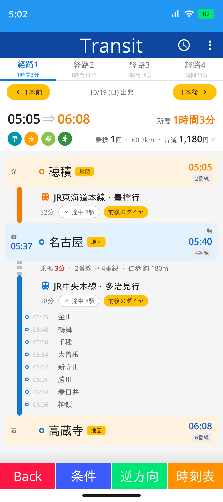
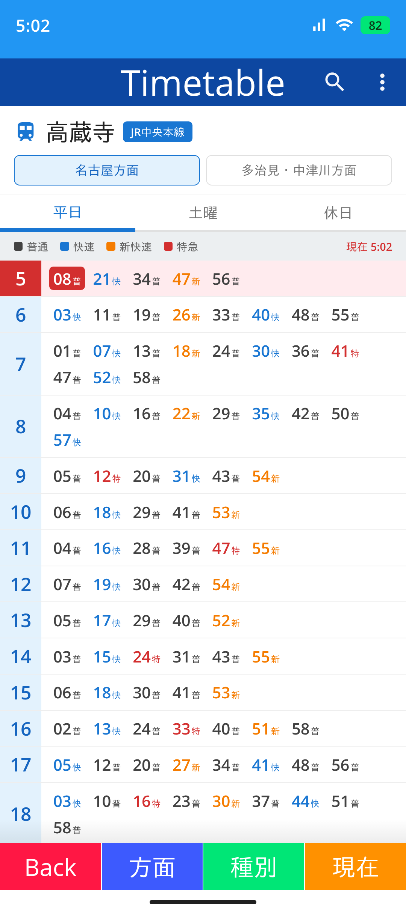

- ViewId: `UITransit` / `UITransitTimetable`
- Vertical rail colored per segment, transfer node, collapsible intermediate stops
- Route candidate tabs, previous / next departure, fare and duration summary
- Timetable: hour x minute matrix, train type color, current time row
- Reuse: BindableLayout / Graphics.Drawing

## Seat

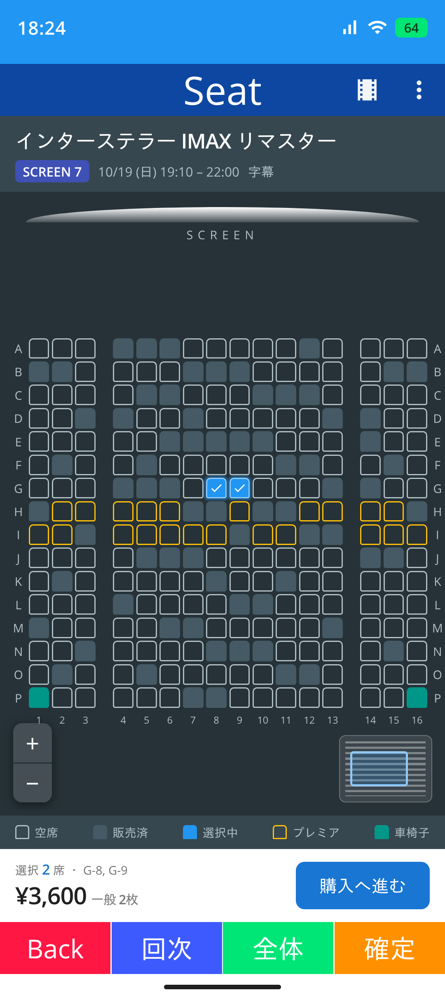

- ViewId: `UISeat`
- Seat map with aisles - available / sold / selected / premium / wheelchair
- Pinch zoom and pan over a large element count, hit test by coordinate, minimap
- Reuse: Graphics.Drawing / TouchOption

## Gantt

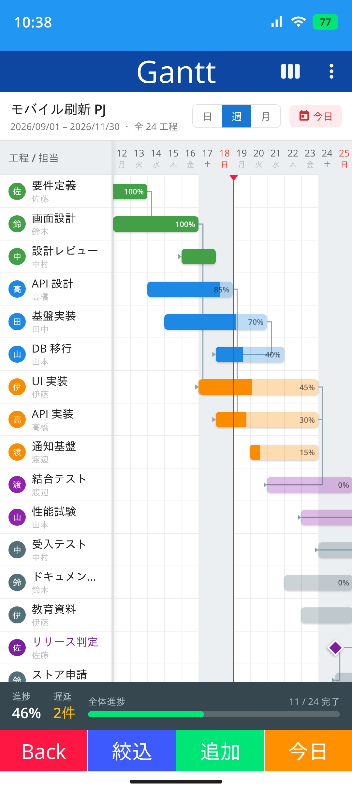

- ViewId: `UIGantt`
- Fixed task column with a horizontally scrolling date area, synchronized vertical scroll
- Today line, dependency links, progress inside the bar, day / week / month zoom
- Reuse: ClamGrid / Scroll behavior

## Kanban

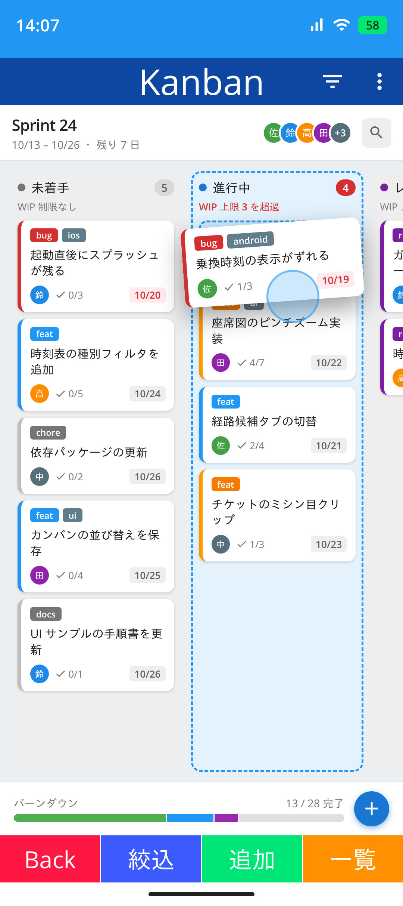

- ViewId: `UIKanban`
- Lanes scrolled horizontally, card drag and drop between lanes
- Drop placeholder, lane highlight, WIP limit warning
- Reuse: View Drag & Drop / CollectionView

## Ticket

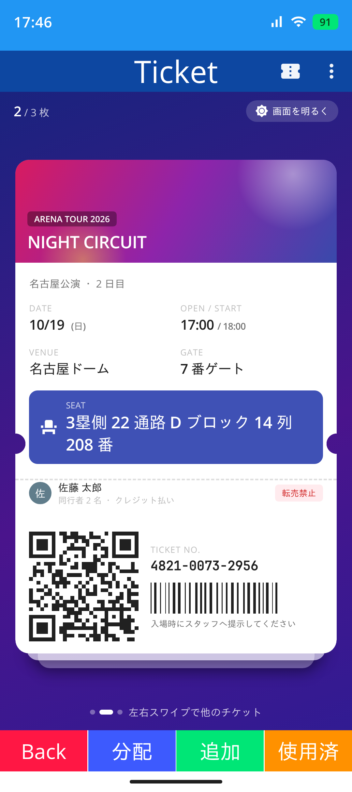

- ViewId: `UITicket`
- Ticket shape with perforation notches - non rectangular clip
- Stacked passes, QR code and barcode, screen brightness boost
- Reuse: BarcodeView / IScreen

# 🅱 Secondary

## Music

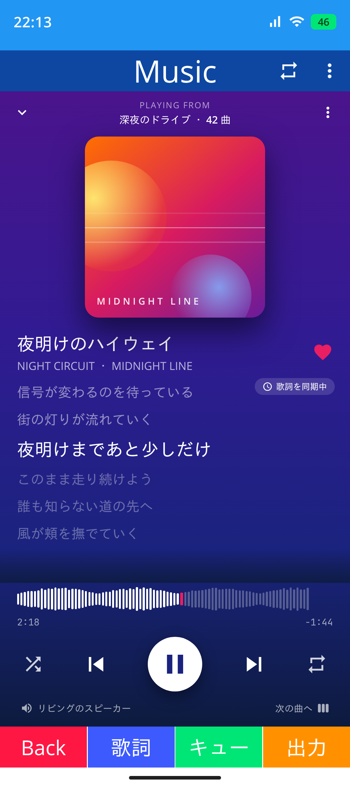

- ViewId: `UIMusic`
- Synchronized lyrics scrolling with the current line highlighted
- Waveform seek bar, background color taken from the artwork
- Reuse: ColorExtractor / MediaBind / Bottom sheet

## Gallery

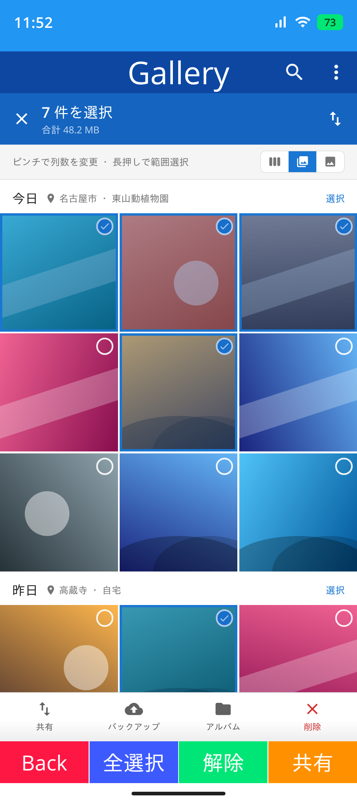

- ViewId: `UIGallery`
- Sticky date headers, pinch to change the column count
- Selection mode with a count toolbar and range selection
- Reuse: CollectionView / StaggeredGrid

## Health

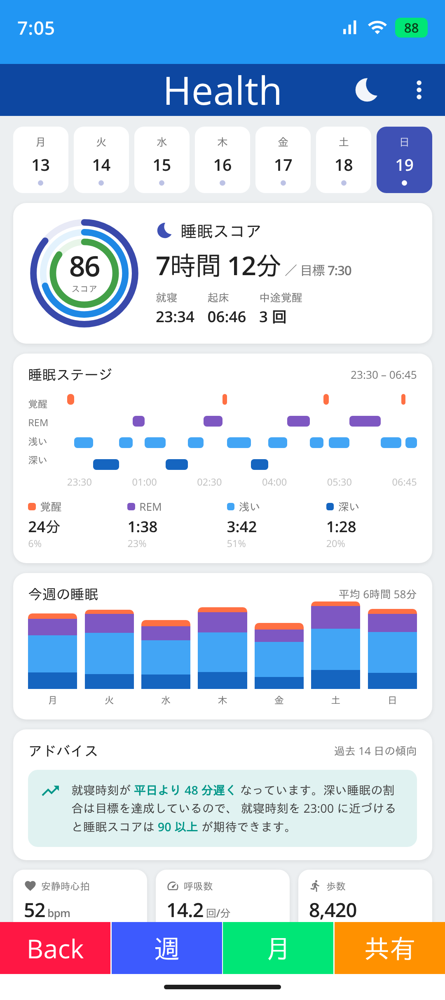

- ViewId: `UIHealth`
- Sleep stage chart, multi ring score, weekly stacked bars
- Reuse: Graphics.Drawing / ArcMeter

## Navi

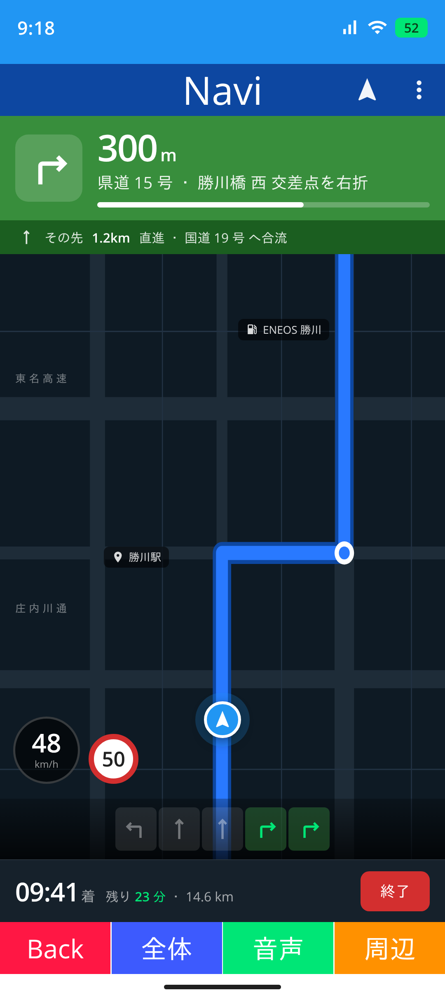

- ViewId: `UINavi`
- Turn by turn header with remaining distance and progress
- Lane guidance, current speed and speed limit, ETA bar
- Reuse: Graphics.Scene / MapBind

## Score

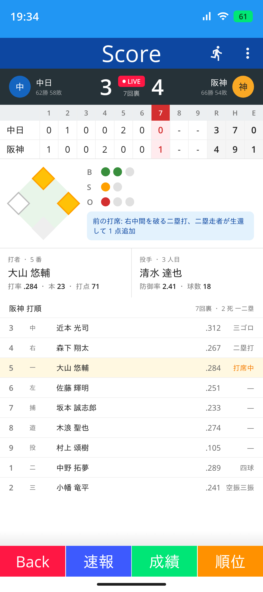

- ViewId: `UIScore`
- Inning scoreboard, diamond with runners, ball / strike / out count, lineup
- Reuse: Graphics.Drawing

## Filer

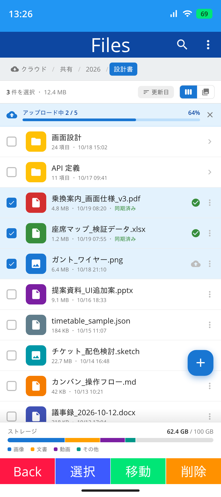

- ViewId: `UIFiler`
- Breadcrumb navigation, list / grid switch, multi select
- Transfer progress banner, storage usage bar
- Reuse: StorageManager / CollectionView

## Trade

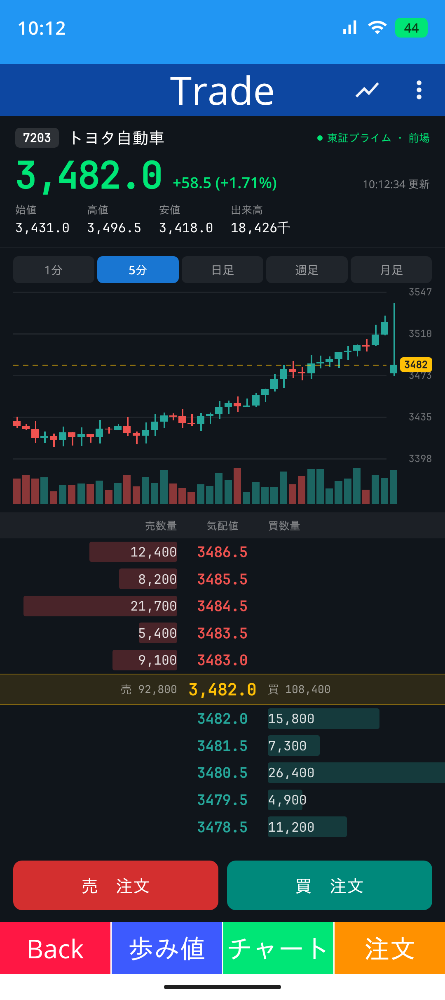

- ViewId: `UITrade`
- Candlestick chart with volume, order book with depth bars
- High frequency update
- Reuse: Graphics.Drawing / View Chart

# 🛠 Implementation

- Add entries to `Modules/ViewId.cs`
- `UIMenu1View` and `UIMenu2View` are full at 9 rows x 2 columns, so `UIMenu3View` is required
- Place sample data under `Models/Sample`
- Update [Example06_UI](Example06_UI.md) and [README](../README.md) after implementation
